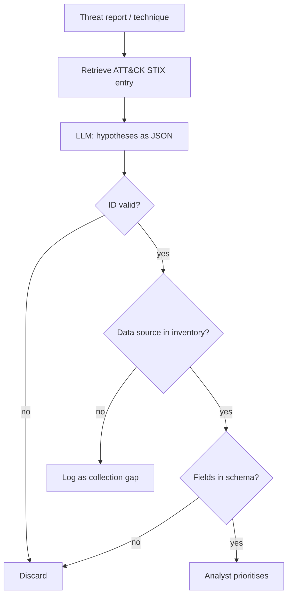

# Hypothesis Generation from ATT&CK

A hunt without a hypothesis is browsing. A good hypothesis names a behaviour, the data that would show it, and what would count as confirmation. LLMs are useful here because they can read threat reports and ATT&CK entries quickly and propose many candidate hypotheses. The checks are whether each hypothesis is testable in your data and whether it is worth testing.

## Anatomy of a testable hypothesis

| Element | Example |
|---|---|
| Behaviour | An adversary uses scheduled tasks for persistence (ATT&CK T1053.005) |
| Context | Following recent intel about a group targeting our sector |
| Observable | Task creation events with actions pointing to user-writable paths |
| Data source | Windows Security 4698, Sysmon 1 for `schtasks.exe`, EDR process events |
| Scope | All workstations, last 30 days |
| Confirmation | Task created by non-admin tooling, binary unsigned, not in software inventory |
| Benign explanations | Software updaters, IT scripts |

The last row matters. Listing expected benign causes up front is the best tool you have for false-positive control later.

## Grounding the model

Do not ask a model to recall ATT&CK from memory; give it the data. ATT&CK is published as STIX 2.1 JSON in the `mitre-attack/attack-stix-data` repository, and the `mitreattack-python` library reads it. Retrieve the technique description, its detection notes and its data components, and include them in the prompt. Then ask for hypotheses in a fixed JSON schema so a script can check them.

```json
{
  "technique_id": "T1053.005",
  "hypothesis": "...",
  "data_sources": ["Sysmon EventID 1", "Security 4698"],
  "fields": ["Image", "CommandLine", "TaskName"],
  "confirmation": "...",
  "benign_explanations": ["..."]
}
```

## Checking hypotheses mechanically

Three checks catch most bad hypotheses before an analyst spends time:

1. **Technique ID exists** in the current ATT&CK release and matches the stated behaviour.
2. **Data sources exist** in your environment: compare the hypothesis's sources with your log inventory.
3. **Fields exist** in your schema: compare against the actual field list of the index or table.



The "collection gap" branch is valuable on its own. A model proposing hypotheses you cannot test is a cheap way to discover missing telemetry.

## From threat reports to techniques

Intel usually arrives as prose: a vendor blog, an ISAC bulletin, a government advisory. A common first task is extracting the techniques it describes. A model can propose ATT&CK mappings for each paragraph, but mappings are notoriously subjective, and models tend to over-map (every mention of PowerShell becomes T1059.001 even when the report only says the tool was present). Two checks help. First, require the model to quote the exact sentence that supports each mapping, and verify with a substring match that the quote exists in the report. Second, compare a sample of mappings with an analyst's, and track agreement over time. MITRE's own Threat Report ATT&CK Mapper (TRAM) project exists for this extraction problem and is a useful baseline.

Treat the report itself as untrusted input. Reports quote attacker commands, file names and ransom notes; that text goes into your prompt exactly like log data does.

## Prioritising

Rank hypotheses by relevance (does the intel apply to you?), data readiness, and expected yield. A model can draft a rationale; the analyst decides. Keep a backlog so hypotheses that were not run are not lost.

## Worked example

> **Execution status:** not executed in this book's CI; the commands and code below are illustrative. Verify locally in an authorised lab before relying on them, and check tool flags against your installed versions.

Generate and check hypotheses for persistence techniques.

1. Fetch ATT&CK data and list the sub-techniques of Scheduled Task/Job:

```python
from mitreattack.stix20 import MitreAttackData
attack = MitreAttackData("enterprise-attack.json")   # from attack-stix-data
t = attack.get_object_by_attack_id("T1053.005", "attack-pattern")
print(t.name)
print(t.description[:500])
```

2. Build a prompt containing the technique description, your log inventory (for example "Sysmon 1, 3, 11, 13; Security 4688, 4698; no EDR on servers") and the JSON schema. Ask for five hypotheses.
3. Validate the response with a script:

```python
import json
inventory = {"Sysmon EventID 1", "Sysmon EventID 11", "Security 4698", "Security 4688"}
for h in json.load(open("hypotheses.json")):
    obj = attack.get_object_by_attack_id(h["technique_id"], "attack-pattern")
    missing = set(h["data_sources"]) - inventory
    status = "INVALID_ID" if obj is None else ("GAP " + ", ".join(missing) if missing else "READY")
    print(h["technique_id"], status, h["hypothesis"][:70])
```

4. Review the `READY` hypotheses and pick one to hunt in chapter 3. Write the `GAP` items into your collection backlog.
5. Record how many of the model's hypotheses were invalid, gaps or ready. That ratio is your first quality metric for this stage.

## Common pitfalls

- Letting the model invent technique IDs or cite old ATT&CK versions; always resolve against the current STIX data.
- Hypotheses that restate the technique ("adversary uses scheduled tasks") without an observable.
- No benign explanations, which guarantees a noisy hunt.
- Generating fifty hypotheses and running none; cap the batch and track the backlog.
- Feeding the model a threat report that contains attacker-supplied text without treating it as untrusted input.

## Exercises

1. Generate hypotheses for three techniques relevant to your sector and report the invalid/gap/ready ratio.
2. Produce a collection-gap list from the `GAP` results and estimate the effort to close each gap.
3. Compare model-generated hypotheses to ones written by an analyst for the same technique, blind, and record which were preferred and why.

## Further reading

- [ATT&CK STIX data](https://github.com/mitre-attack/attack-stix-data) and [mitreattack-python](https://github.com/mitre-attack/mitreattack-python).
- [MITRE Cyber Analytics Repository (CAR)](https://car.mitre.org/) and [TRAM](https://github.com/center-for-threat-informed-defense/tram).
- Splunk SURGe, PEAK framework papers (2023).
- Sibling book: **decentralized-threat-intelligence** for intel sharing that feeds hypotheses.
