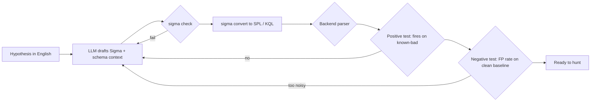

# Natural Language to KQL, SPL and Sigma, with Validation

Query writing is where LLMs save hunters the most time and cause the most silent failures. A model can turn "find scheduled tasks created from user temp folders" into KQL, SPL or a Sigma rule in seconds. It can also use a field that does not exist, the wrong case sensitivity, a table from another product, or a time window that excludes the attack. Every one of those queries can parse and return zero rows. This chapter builds a validation pipeline so that a generated query is trusted only after it has passed checks.

## Three targets, three failure profiles

| Language | Where | Common model errors |
|---|---|---|
| KQL | Microsoft Sentinel, Defender XDR, Azure Data Explorer | Wrong table (`SecurityEvent` vs `DeviceProcessEvents`), invented columns, `contains` vs `has` semantics |
| SPL | Splunk | Wrong index/sourcetype, unescaped backslashes, field names that depend on add-ons |
| Sigma | Vendor-neutral YAML rules | Invalid modifiers, wrong `logsource`, fields that the target pipeline does not map |

Sigma is the best intermediate format for AI-generated logic because it is structured, has a validator, and converts to many backends through pySigma. Microsoft researchers have also published on direct NL-to-KQL generation ("NL2KQL", 2024), stressing schema grounding: give the model the actual table and column names rather than hoping it remembers them.

## The validation pipeline



Each gate is a tool, not a judgement:

1. **Schema grounding.** Put the real field list into the prompt. For Splunk, `| fieldsummary` on a sample gives it; for KQL, `getschema` on a table.
2. **Syntax.** `sigma check` for Sigma. For SPL, Splunk's REST endpoint `services/search/parser` parses a search without running it. For KQL, Microsoft's open-source `Kusto.Language` parser, or running with `| take 0`.
3. **Positive test.** Replay the query against labelled malicious events (the lab from chapter 1, or Atomic Red Team output). It must match.
4. **Negative test.** Run against a clean baseline window and count hits. Compare with the benign explanations from the hypothesis.
5. **Diff review.** An analyst reads the final query. Short queries are reviewable; this is not optional.

When a gate fails, feed the exact error back to the model and let it retry, with a cap of two or three attempts. Beyond that, a human writes the query. Unlimited retry loops tend to converge on queries that pass the tests by being trivially broad, which is why the negative test must run after every revision, not just the first.

Keep the prompt short and boring: the hypothesis, the schema, two example rules from your own repository in the house style, and the output format. Few-shot examples from your own rules do more for quality than any instruction about being careful.

## Worked example

> **Execution status:** not executed in this book's CI; the commands and code below are illustrative. Verify locally in an authorised lab before relying on them, and check tool flags against your installed versions.

Turn the scheduled-task hypothesis from chapter 2 into a validated hunt.

1. Prompt the model with the hypothesis, the Sysmon field list (`Image`, `CommandLine`, `ParentImage`, `User`, ...) and the instruction "output one Sigma rule only". A good result looks like:

```yaml
title: Scheduled Task Created Pointing to User-Writable Path
id: 5f0c7b5e-2a1d-4b8e-9f3c-1d2e3f4a5b6c
status: experimental
logsource:
  product: windows
  category: process_creation
detection:
  selection_img:
    Image|endswith: '\schtasks.exe'
    CommandLine|contains: '/create'
  selection_path:
    CommandLine|contains:
      - '\AppData\'
      - '\Temp\'
      - '\Users\Public\'
  condition: selection_img and selection_path
falsepositives:
  - Software updaters installed per-user
level: medium
tags:
  - attack.persistence
  - attack.t1053.005
```

2. Validate and convert:

```bash
sigma check schtasks_userpath.yml
sigma convert -t splunk -p sysmon schtasks_userpath.yml
```

3. Parse the SPL without executing it (adjust host and credentials for your lab):

```bash
curl -sk -u admin:changeme -G https://localhost:8089/services/search/parser \
  --data-urlencode 'q=search index=sysmon Image="*\\schtasks.exe" CommandLine="*/create*"' \
  --data-urlencode output_mode=json | jq '.commands[0].command'
```

4. Positive test: on a Windows test VM you are authorised to use, run the matching Atomic Red Team test for T1053.005 (`Invoke-AtomicTest T1053.005 -TestNumbers 1`), collect the Sysmon logs, and confirm the converted query returns the event. Alternatively, run Chainsaw with your rule over a public EVTX sample that contains the technique.
5. Negative test: run the query over a week of normal data and list distinct `Image`/`CommandLine` pairs. Add filters for verified benign updaters, and record each filter with a reason.
6. Store the rule, the test event and the baseline count in Git. The next model-generated change must pass the same tests.

A KQL equivalent for Defender data, for comparison, after the same checks:

```kusto
DeviceProcessEvents
| where FileName =~ "schtasks.exe" and ProcessCommandLine has "/create"
| where ProcessCommandLine has_any (@"\AppData\", @"\Temp\", @"\Users\Public\")
| project Timestamp, DeviceName, AccountName, ProcessCommandLine, InitiatingProcessFileName
```

## Common pitfalls

- Trusting zero results from an untested query.
- Skipping schema grounding and getting columns from the wrong product.
- Generating SPL with single backslashes, which Splunk treats as escapes.
- Running model-generated queries with expensive wildcards over all indexes and all time.
- Letting the model "fix" a failing positive test by broadening the query until it matches everything.

## Exercises

1. Generate five Sigma rules from hypotheses, run `sigma check` on each, and record the failure rate and error types.
2. Build a script that converts a Sigma rule to SPL and KQL and runs positive and negative tests automatically.
3. Compare a model-written query to an expert-written one on the same dataset: matches, misses and false positives.

## Further reading

- [Sigma](https://github.com/SigmaHQ/sigma), [pySigma](https://github.com/SigmaHQ/pySigma) and [sigma-cli](https://github.com/SigmaHQ/sigma-cli).
- [Kusto Query Language parser](https://github.com/microsoft/Kusto-Query-Language).
- [Atomic Red Team](https://github.com/redcanaryco/atomic-red-team).
- Microsoft, "NL2KQL: From Natural Language to Kusto Query", 2024.
- Sibling book: **ai-static-analysis-rule-writing** for the same propose-and-verify pattern applied to code rules.
