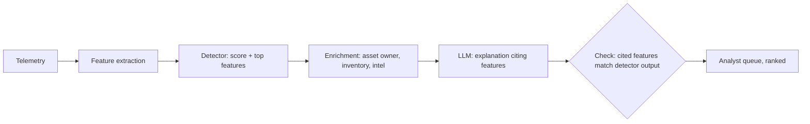

# Anomaly Detection with LLM Explanation and False-Positive Control

Statistical anomaly detection finds the unusual; it does not say whether the unusual is bad. That gap is why many anomaly programmes drown in alerts. A useful division of labour: classical models score anomalies, deterministic enrichment adds context, and an LLM writes the explanation an analyst reads. The model never computes the score, and its explanation is checked against the features that produced the score.

## Pick the detector for the data

| Data | Detector | Typical anomaly |
|---|---|---|
| Network connection logs (Zeek `conn.log`) | Beacon scoring on interval regularity and size (as in RITA) | Command-and-control beaconing |
| Authentication events | Per-user baselines: rare source, rare time, impossible travel | Credential misuse |
| Process events | Rarity of parent-child pairs across the fleet ("stack counting") | Living-off-the-land execution |
| Mixed numeric features | Isolation Forest, robust z-scores | Outlier hosts or users |
| DNS | Entropy and length of query names, new domains | Tunnelling, DGA domains |

Stack counting — counting how often each value occurs across the fleet and looking at the rare tail — is old, cheap and still one of the most productive hunting techniques. Start there before reaching for neural models.

## Where the LLM fits



The prompt contains the score, the top contributing features with their values and baselines, and enrichment facts. The model's job is to explain in plain language and suggest the next query. A checker confirms every number and feature named in the explanation appears in the input. Explanations that mention features the detector did not use are rejected.

## False-positive control

False positives are the main cost of anomaly hunting. Control them with process, not hope:

1. **Suppression with reasons.** Every allow-list entry records who added it, why, and an expiry date.
2. **Feedback loop.** Analyst dispositions (true positive, benign, needs tuning) are stored and reviewed monthly.
3. **Alert budgets.** Fix the number of anomalies per day the team can review and tune thresholds to that budget, then measure what the budget catches.
4. **Precision tracking.** Report precision per detector, not one overall number.
5. **Do not let the model suppress.** It may suggest a suppression; a person approves it, with the reason.

LLM explanations can make false positives worse in a subtle way: a confident explanation of why an anomaly is malicious can persuade an analyst. Show the score and features above the explanation, and phrase the model's output as "possible explanations" with benign options listed first.

## Worked example

> **Execution status:** not executed in this book's CI; the commands and code below are illustrative. Verify locally in an authorised lab before relying on them, and check tool flags against your installed versions.

Score beaconing candidates from Zeek logs and explain the top results.

1. Extract per-pair connection timings from `conn.log` with `zeek-cut`:

```bash
zcat conn.*.log.gz | zeek-cut ts id.orig_h id.resp_h id.resp_p orig_bytes > conn.tsv
```

2. Score interval regularity with a short script (a simplified version of the idea RITA implements):

```python
import pandas as pd, numpy as np
df = pd.read_csv("conn.tsv", sep="\t", names=["ts","src","dst","port","bytes"])
df["bytes"] = pd.to_numeric(df["bytes"], errors="coerce")
rows = []
for (s, d, p), g in df.groupby(["src","dst","port"]):
    if len(g) < 20: continue
    iv = np.diff(np.sort(g.ts.values))
    cv = iv.std() / iv.mean() if iv.mean() > 0 else 1
    rows.append({"src": s, "dst": d, "port": p, "n": len(g),
                 "interval_cv": round(cv, 3), "bytes_median": g.bytes.median()})
out = pd.DataFrame(rows).sort_values("interval_cv").head(20)
out.to_json("candidates.json", orient="records")
```

A low coefficient of variation means very regular intervals.

3. Enrich each candidate with destination reputation, first-seen date and asset owner from your inventory (deterministic lookups).
4. Ask the model for an explanation per candidate, citing the fields by name, with at least two benign hypotheses (for example update checks, NTP, monitoring agents) before any malicious one.
5. Check: every number in the explanation must equal a value in the candidate record.

```python
import re, json
cand = json.load(open("candidates.json"))[0]
expl = open("expl0.txt").read()
vals = {str(v) for v in cand.values()}
for num in re.findall(r"\d+(?:\.\d+)?", expl):
    if num not in vals: print("UNSUPPORTED NUMBER:", num)
```

6. An analyst dispositions the top ten. Record precision. If a known monitoring agent dominates, add a suppression with a reason and expiry.

## Common pitfalls

- Asking the LLM to "find anomalies" in raw logs; it cannot count reliably at scale.
- Explanations that drift beyond the features the detector used.
- Permanent, undocumented allow-lists that become blind spots attackers can hide in.
- Treating jittered beacons as safe because the coefficient of variation is moderate; jitter is a standard evasion.
- Measuring "alerts closed" rather than true positives found.

## Exercises

1. Run the beacon scorer on a lab capture that includes a known benign beacon (for example a monitoring agent) and confirm where it ranks.
2. Implement the number-and-feature checker and report the rejection rate for 30 explanations.
3. Design an alert budget for one detector and measure precision for two weeks.

## Further reading

- [Zeek](https://zeek.org/) and [RITA](https://github.com/activecm/rita) for beacon analysis.
- [scikit-learn IsolationForest](https://scikit-learn.org/stable/modules/generated/sklearn.ensemble.IsolationForest.html).
- Liu, Ting and Zhou, "Isolation Forest", ICDM 2008.
- Sommer and Paxson, "Outside the Closed World: On Using Machine Learning for Network Intrusion Detection", IEEE S&P 2010.
- Sibling book: **adversarial-ml-security-classifiers** for evasion of ML detectors.
