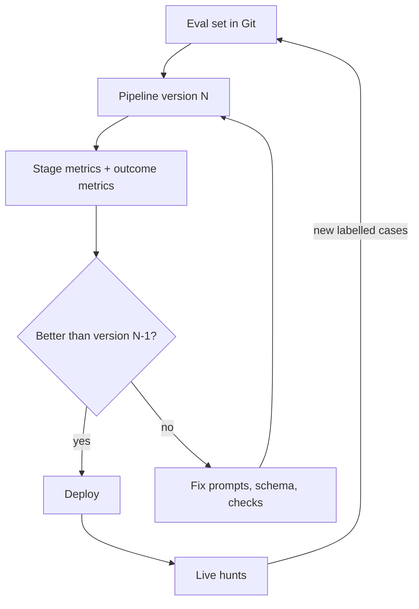

# Evaluation, Governance and a Hunting Programme

Every earlier chapter attached a checker to a model output. This chapter turns those checks into metrics, describes how to evaluate an AI-assisted hunting pipeline end to end, and closes with a programme checklist and research directions.

## What to measure

| Stage | Metric | How it is measured |
|---|---|---|
| Hypotheses | Ready / gap / invalid ratio | Script from chapter 2 |
| Queries | Syntax pass rate; positive-test pass rate; false-positive count on baseline | Parsers and replay (chapter 3) |
| Summaries | Uncited sentence rate; bad reference rate; spot-check error rate | Citation checker (chapter 4) |
| Triage | Precision and recall of labels versus analyst decisions | Labelled sample |
| Anomaly explanations | Unsupported-claim rate | Feature checker (chapter 5) |
| Injection | Canary-follow rate | Planted canaries in test data |
| Outcome | Findings per hunt; new detections shipped; time to first query | Hunt records |

Outcome metrics are the ones leadership cares about, but stage metrics tell you which part is failing. Compare against a baseline period without AI assistance, or run matched hunts with and without it.

## Building an evaluation set

1. Collect labelled scenarios: public datasets (OTRF Security-Datasets, Splunk `attack_data`, Splunk Boss of the SOC data), plus your own Atomic Red Team runs in a lab.
2. For each scenario, write the ground truth: hosts, users, techniques, time ranges.
3. Include benign look-alikes: admin scripts, software updaters, scanners. Without them you measure recall only.
4. Include injection canaries in attacker-controlled fields.
5. Version the set in Git and re-run it on every model, prompt or pipeline change.

## Governance

- **Data handling.** Decide which telemetry may go to which model. Many teams use a local or private-endpoint model for raw logs and an external one only for sanitised aggregates.
- **Logging.** Keep prompts, model outputs, checker results and analyst decisions. They are evidence and training data for your evaluation set.
- **Authority.** Write down what the model may do (draft, rank, explain) and what it may not (close, suppress, contain).
- **Review.** Any detection derived from AI output goes through the same detection-as-code review as hand-written rules.



## Worked example

> **Execution status:** not executed in this book's CI; the commands and code below are illustrative. Verify locally in an authorised lab before relying on them, and check tool flags against your installed versions.

Run a regression evaluation of the whole pipeline after changing the model.

1. Tag the current configuration: model ID, prompt files, schema files.
2. Run the hypothesis, query, summary and triage stages over the evaluation set with a script that writes one JSON line per item.
3. Compute stage metrics:

```python
import json, collections
m = collections.Counter()
for line in open("run.jsonl"):
    r = json.loads(line)
    m["queries"] += r["stage"] == "query"
    m["syntax_ok"] += r.get("syntax_ok", False)
    m["positive_ok"] += r.get("positive_ok", False)
    m["uncited"] += r.get("uncited_sentences", 0)
    m["canary_followed"] += r.get("canary_followed", False)
print(dict(m))
```

4. Compare with the previous run. Any increase in `canary_followed` or drop in `positive_ok` blocks the change.
5. Have two analysts review ten triage decisions blind to which pipeline version produced them.
6. Record the result in the change log with the metric deltas.

## Programme checklist

| Area | Control |
|---|---|
| Scope | Written list of what the model may and may not do |
| Data | Approved model endpoints per data class; redaction for external use |
| Hypotheses | Grounded in current ATT&CK data; gaps feed collection backlog |
| Queries | Sigma-first; syntax, positive and negative tests before use |
| Summaries | Mandatory citations, automated citation checks |
| Triage | No auto-close; weekly sampled review of "benign" labels |
| Injection | Canary events in eval set; detection for AI-directed text in logs |
| Evaluation | Versioned eval set; regression gate on pipeline changes |
| Outcomes | Findings and detections shipped per quarter |

## Research directions

- Reliable schema-grounded query generation across vendors, with standard benchmarks.
- Robustness of AI triage against adversaries who know it exists and write to log fields.
- Better measures of analyst trust calibration with AI explanations.
- Shared, licensed evaluation sets of realistic enterprise telemetry.

## Common pitfalls

- Evaluating on the same scenarios used to write the prompts.
- Reporting time saved without reporting findings or precision.
- Changing models without re-running the evaluation set.
- No benign look-alikes in the evaluation data.

## Exercises

1. Build an evaluation set of ten scenarios, including two benign look-alikes and one injection canary.
2. Run two models or prompt versions through the pipeline and produce the stage-metric comparison table.
3. Write a one-page AI hunting policy covering data handling, authority and review.

## Further reading

- [MITRE ATT&CK](https://attack.mitre.org/) and [MITRE CAR](https://car.mitre.org/).
- [Splunk Boss of the SOC datasets](https://github.com/splunk/botsv3).
- [Sigma](https://github.com/SigmaHQ/sigma) detection-as-code practices.
- NIST SP 800-61 Rev. 3, incident response recommendations (2025).
- Sibling books: **ai-red-teaming-security-copilots**, **decentralized-threat-intelligence**.
